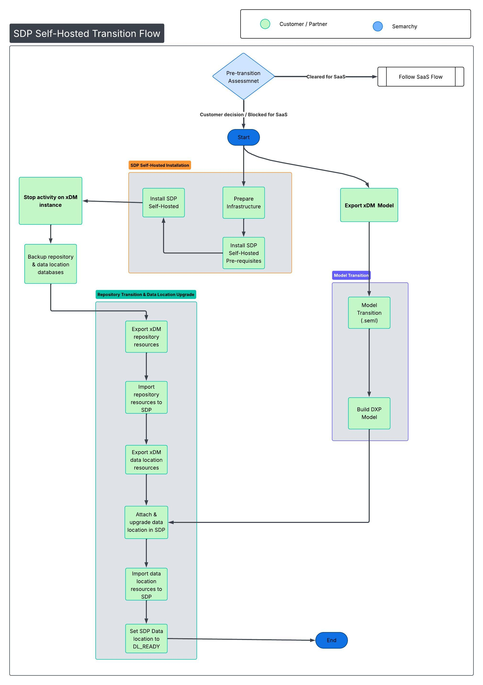
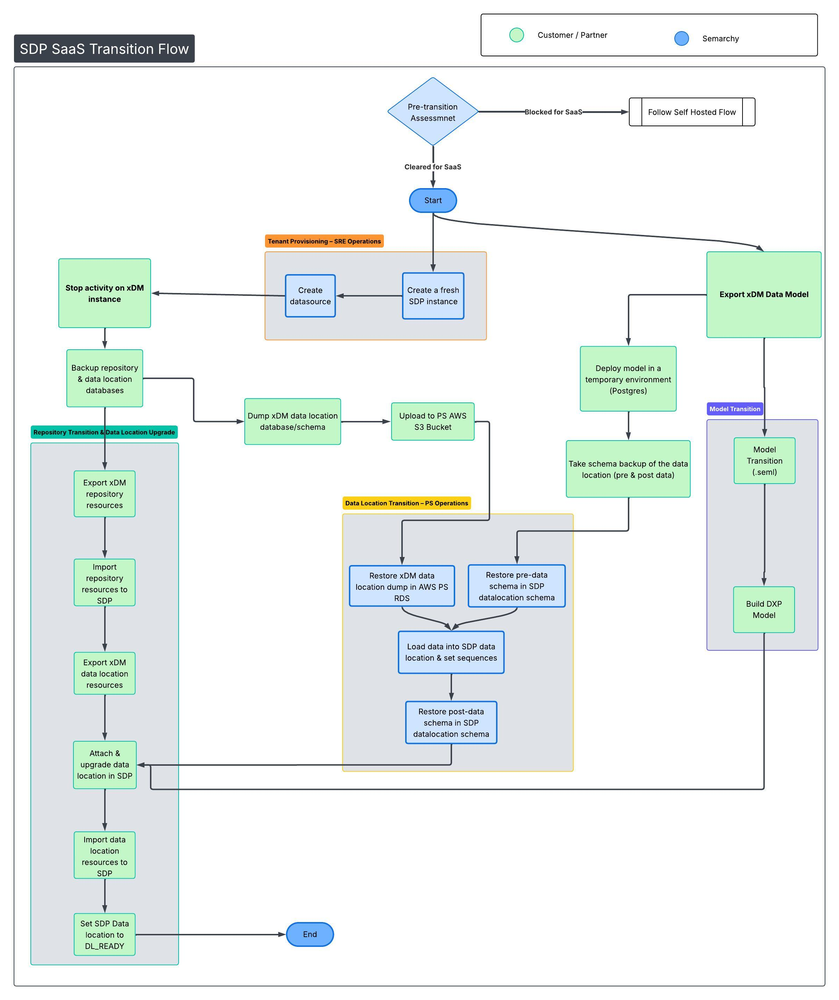

This repository hosts examples of scripts and methodology elements that aim to help customers and partners to automate and simplify the transition process from Semarchy xDM 2024.1/2025.1 to Semarchy Data Platform.

This repository is maintained by Semarchy Professional Services team.

## Overview

The process for transitioning an existing self-hosted Semarchy xDM instance to the Semarchy Data Platform (SDP) SaaS and Self-Hosted environment involves three main transition streams that must be synchronized:

1. **Model Transition:** Converting the model from xDM App Builder to the new VS Code extension for DesignXP.

2. **Data Location Transition (SaaS only):** Moving the actual physical data  and schema, from the xDM data location, to SDP. This part is not covered by artifacts in the current repository as it's part of Semarchy Professional Services package.

3. **Repository Transition:** Moving the xDM repository configurations (Users, Roles, Plugins, etc.).and the data location metadata (Integration Loads, Batches, Data Notifications, etc.)

## Prerequisites

Each of the three transition steps has its own set of prerequisites, however, before getting started, ensure that the following high-level prerequisites are met:

- **xDM version** currently is at 2024.1.x or 2025.1.x

- **SDP Tenant** (for SaaS only) is provisioned and running

- **SDP Self-Hosted** (for self-hosted only) is installed

- **DXP VS Code extension** is installed with version 1.5.0 or later

- **Pre-transition assessment**  has been completed with the Semarchy Professional Services team

 For reference, here are the high-level flow diagrams for transitionning. Please, note that these might be different for your specific projects. Exact process will depend on your existing xDM implementation as well as your requirements for parallel run and acceptable downtime.

The logical flow for a transition from self-hosted xDM to SDP self-hosted:

The logical flow for transition from self-hosted xDM to SDP SaaS:

## Transition Assessment

Most often Semarchy Professional Services team delivers the Transition Assessment for a given project to ensure that it is done in full alignment with the latest state of SDP knowledge and best practices.

However you can refer to [transtion-assessment](./transition-assessment/README.md) folder of this project for more details on the transition methodology. There are also scripts that simplifies analysis around your current implementation.

## Data Model Transition

This phase moves the logical definition of the application.

1. **Freeze Source:**
   - Ensure no development is happening on the source instance.

2. **Export Model:** In the Source xDM App Builder, export the model.

3. **Import to VS Code:**
   - Create a new project in VS Code.
   - Import the model using the Semarchy xDM Extension.

4. **Validate:** Run model validation. Fix any errors (often related to SQL vs. SemQL strictness or deprecated features).\
   Note: When targeting SDP on SaaS, the reference to custom plugins and database functions must be removed.

5. **Hold for Deployment:** Keep this model ready; it will be deployed to SDP _after_ the repository is migrated but _before_ the data is finalized.

Official documentation for the Data Model Transition tool is available [here](https://docs.semarchy.com/saas/guides/design/modeling/convert-xml-model).

## Repository Transition

This phase moves global configurations (Roles, Users, Policies) and re-attach the migrated datalocation and upgrade it.
This process is handled through dedicated transition scripts that invoke the xDM REST APIs to export repository definitions and data location metadata and further invoke SDP REST APIs to import the same to SDP.

The exported information is consolidated and stored in JSON format within a workspace on the local system. Prior to importing this metadata into SDP, the generated JSON files can be reviewed and modified to align with specific transition requirements, target environment constraints, or organizational standards. These adaptations ensure a smoother import process and help validate that the repository configuration is correctly mapped for the SDP environment.

Sample scripts are available as part of this project under [repository-upgrade](./repository-upgrade/README.md). These scripts are a base line that covers transition of all elements in the repository from xDM to SDP. They can and should be customized for your project. 